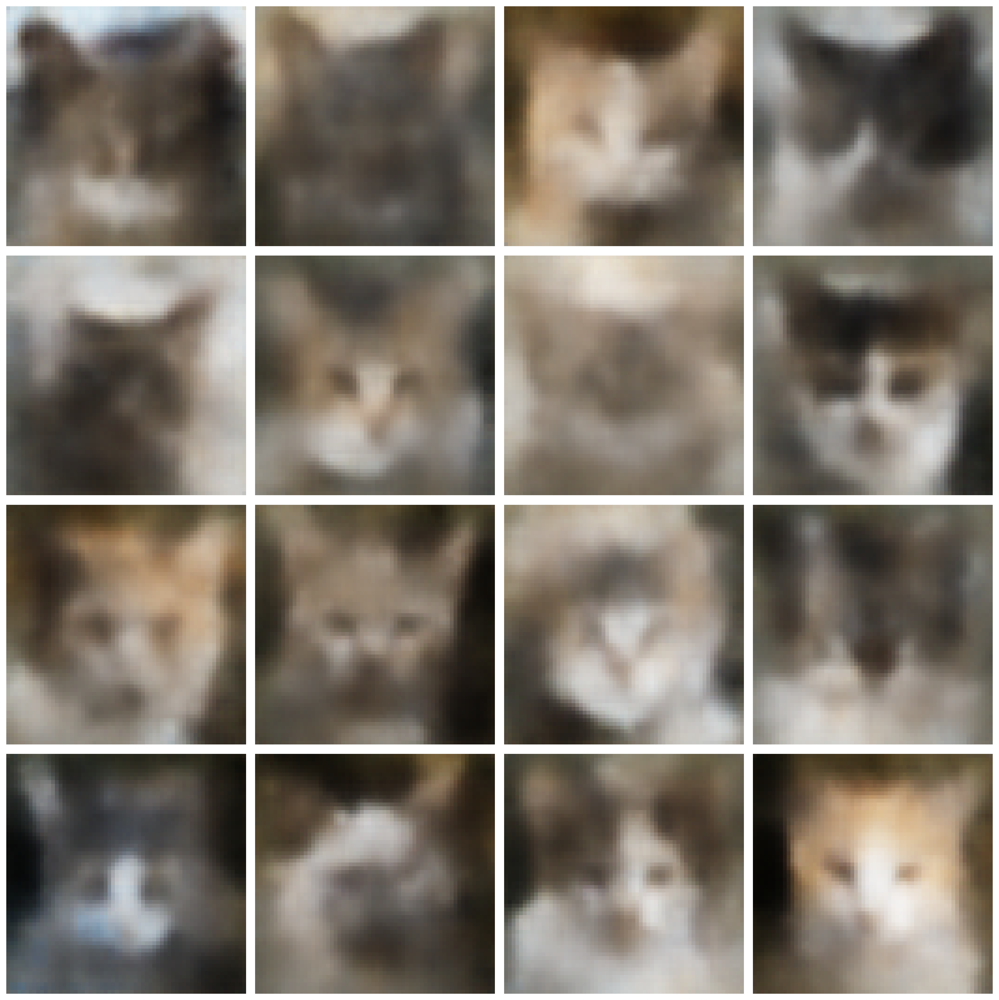

# Variational Autoencoder for Cat Image Generation

This project is an implementation and experimental study of a **Variational Autoencoder (VAE)** for cat image reconstruction and generation.

<p align="center">
  
</p>

<p align="center">
  <i>Example images generated by the VAE from samples drawn from the latent prior.</i>
</p>

## Goal

The main goal of the project is to build a VAE capable of generating **recognizable and diverse cat images from the prior distribution**

$$
z \sim \mathcal{N}(0,I)
$$

while keeping reconstruction and generation blur relatively small.

The project investigates how different components of a VAE influence:

- reconstruction quality,
- generation quality,
- image blur,
- latent-space utilization,
- and the trade-off between reconstruction accuracy and prior regularization.

The final objective is:

**meaningful prior generation + moderate blur + effective use of latent information**

---

## Project Overview

The project started with a simple MLP-based VAE and was later extended with convolutional architectures designed for image data.

The current implementation supports:

- MLP and CNN VAE architectures,
- Gaussian latent variables,
- the reparameterization trick,
- configurable latent-space dimensionality,
- configurable KL weight $\beta$,
- stochastic and deterministic latent representations,
- KL annealing,
- multiple reconstruction objectives,
- reusable experiment configurations,
- comparison of multiple trained models,
- reconstruction visualization,
- KL divergence analysis per latent dimension,
- training and validation loss visualization.

---

## Dataset

The main experiments use the **cat subset of AFHQ**:

[AFHQ Dataset on Kaggle](https://www.kaggle.com/datasets/dimensi0n/afhq-512?select=cat)

Images are resized to:

```text
64 x 64 RGB
```

and used as unsupervised training data.

Near-duplicate images are grouped before creating the train, validation and test splits in order to reduce leakage of visually similar images between subsets.

---

## Models

### MLP VAE

The first baseline used fully connected encoder and decoder networks.

It implemented:

- Gaussian posterior approximation,
- learned posterior mean and variance,
- the reparameterization trick,
- Gaussian reconstruction likelihood,
- KL-divergence regularization.

The MLP model was useful as an initial baseline, but produced strongly blurred reconstructions and generated images with limited recognizable structure.

### CNN VAE

The current main model uses a convolutional encoder and decoder.

The encoder estimates

$$
\mu(x)
\qquad \text{and} \qquad
\log \sigma^2(x)
$$

and the latent representation can be sampled using

$$
z = \mu + \sigma\epsilon,
\qquad
\epsilon \sim \mathcal{N}(0,I)
$$

The basic training objective is

$$
L = L_{\mathrm{reconstruction}} + 
\beta L_{\mathrm{KL}}
$$

The implementation also supports deterministic experiments using

$$
z = \mu
$$

---

## Reconstruction Objectives

The following reconstruction objectives have been implemented and tested:

- Gaussian reconstruction loss,
- Laplace / L1 reconstruction loss,
- Gaussian reconstruction loss combined with SSIM.

These experiments are used to investigate whether the reconstruction objective itself is responsible for the characteristic blur produced by the VAE.

---

## Experimental Framework

Experiments are defined using reusable configuration objects, allowing controlled comparisons between different VAE setups.

Parameters that can be changed between experiments include:

- latent dimensionality,
- KL weight $\beta$,
- reconstruction loss,
- stochastic or deterministic training,
- stochastic or deterministic reconstruction,
- KL annealing,
- training dataset,
- validation dataset,
- number of epochs.

Multiple experiments can be compared using common visualization tools for:

- reconstructions,
- KL divergence per latent dimension,
- total training and validation loss,
- reconstruction loss,
- KL loss.

This makes it possible to run controlled experiment grids while changing only selected parameters.

---

## Current Research

The current experiments focus mainly on the interaction between **latent-space capacity** and **KL regularization**.

The following latent dimensionalities have been tested:

$$
d_z \in \{32,64,128,256\}
$$

together with:

$$
\beta \in \{0,\;0.1,\;0.5,\;1\}
$$

The results show that increasing latent dimensionality can significantly improve reconstruction quality when KL regularization is weak or absent.

However, as $\beta$ increases, many latent dimensions carry very little image-specific information and the advantage of increasing the nominal latent-space size becomes much smaller.

A key observation is therefore:

$$
\text{nominal latent capacity}
\neq
\text{effective latent capacity}
$$

The current results suggest that reconstruction blur is strongly affected by the interaction between latent-space capacity and KL regularization.

Other completed experiments include:

- stochastic vs. deterministic latent sampling,
- KL annealing,
- Gaussian vs. Laplace reconstruction likelihood,
- Gaussian reconstruction loss combined with SSIM,
- small-dataset overfitting,
- reconstruction without KL regularization,
- latent-capacity experiments without KL regularization.

---

## Current Direction

The next experiments focus on finding a better balance between useful latent information and prior regularization.

Planned work includes:

1. a more precise search for the optimal value of $\beta$,
2. testing larger latent spaces using the selected $\beta$,
3. KL annealing toward the selected target $\beta$,
4. investigating modified KL regularization such as free bits or capacity control,
5. evaluating whether additional encoder and decoder capacity is necessary.

Possible later architectural improvements include:

- deeper convolutional networks,
- additional feature channels,
- residual blocks,
- Group Normalization,
- upsampling followed by standard convolution instead of selected transposed convolutions.

---

## Report

A detailed description of the methodology, experiments, visualizations and conclusions is available in the full project report:

[**Read the full project report**](VAE_report/new_new.pdf)

The report contains the complete experimental analysis, while this README provides only a general overview of the project.

---

## Tech Stack

- **Python**
- **PyTorch**
- **Matplotlib**
- **TorchMetrics**
- **NumPy**

---

## Repository Structure

```text
VAE/
├── data/
├── report/
│   ├── report.tex
│   └── report.pdf
│
├── results/
│   └── CNN_VAE/
│
├── scripts/
│   └── experiments/
│       ├── experiment.py
│       ├── experiment_config.py
│       ├── vae_experiment.py
│       └── experiments_comparison.py
│
├── src/
│   ├── datasets/
│   ├── losses/
│   ├── models/
│   └── ...
│
└── README.md
```

---

## Running Experiments

Experiments are configured using `ExperimentConfig`.

Example:

```python
config = ExperimentConfig(
    name="beta=0.5 latent=128",
    epochs=50,

    train_dataset="full",
    val_dataset="RQ2",

    reconstruction_loss=GaussianLoss(),

    latent_dim=128,
    beta=0.5,

    stochastic_train=True,
    stochastic_reconstruction=False,
)
```

The experiment can then be trained using:

```python
experiment = VAEExperiment(
    config=config,
    root=root
)

experiment.train()
```

Multiple trained models can be collected and compared using:

```python
comparison = ExperimentComparison(
    experiments=experiments,
    test_data=test_data
)
```

This setup is used to perform controlled comparisons between different VAE configurations.